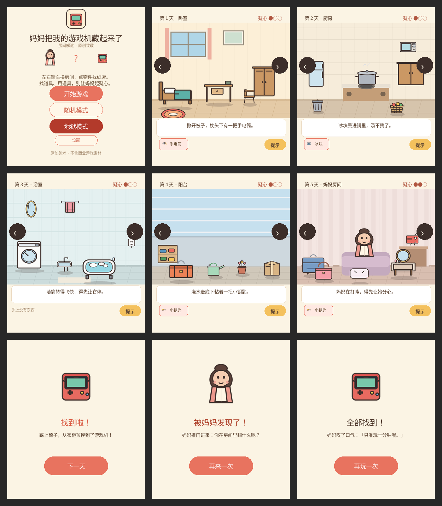

# 妈妈把我的游戏机藏起来了 · 手表版（同人）

一个跑在 **iQOO WATCH GT（BlueOS / 蓝河）** 上的同人解谜小游戏，390×450 方屏适配。

> 非官方作品。玩法致敬 hap Inc. 的《Mom Hid My Game!》，代码、文案、美术均为本项目原创，不包含原作商业素材。

## 玩法

- 5 天剧情：每天一个房间，点物件找线索，部分道具要先用/先找。
- 左右箭头切换房间，道具栏选中后点目标使用。
- 疑心条固定：第 1 天每错 2 次涨 1 格，第 2–5 天每错 1 次涨 1 格；满格被妈妈抓包。
- 随机模式：随机起始房间、目标、工具。
- 地狱模式：2 格疑心、每错 2 次涨 1 格、120 秒限时、三层钥匙链。

## 截图



## 构建

需要 BlueOS Studio（或 blueos-pack 工具链）：

```bash
pnpm i
# BlueOS Studio 里选择 watch-square 编译，或：
node <blueos-pack>/bin/index.js build --device-type watch-square --force
```

产物：`dist/watch-square/<mode>/com.dshgo.hidden.<mode>.1.0.0.rpk`。

> 仓库只含源码，不含 `.rpk` 和签名私钥；打包前请自行生成/放置 `sign/certificate.pem` 与 `sign/private.pem`。

## 目录

```
src/
  manifest.json      # 应用配置（watch-square, designWidth 390）
  app.ux             # 应用入口
  common/levels.js   # 关卡、道具、天数数据
  pages/Home/        # 标题、选关、设置
  pages/Game/        # 游玩、找到、被抓、通关
  assets/images/     # 原创图标与房间图
tools/
  gen_assets.py      # 生成图标
  gen_rooms.py       # 合成房间背景
  mockup_square.py   # 生成设计预览
web-demo/            # 浏览器试玩版
```

## 声明

- 本项目为个人同人练习，与 hap Inc.、vivo/iQOO 无关联。
- 源码仅供学习交流；未经作者许可，不得商用、二次分发或上架付费商店。
- 游戏内不含任何原作图片、音频或 ROM 素材。
